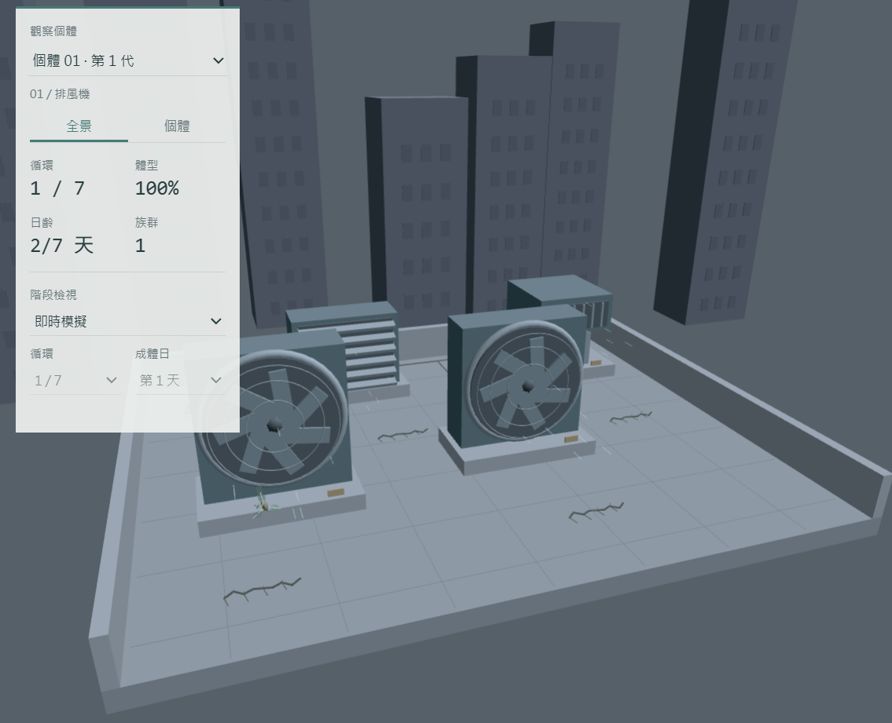

# M2 物種：風囊生物

風囊生物生活在「餘留城市」的屋頂。牠以日光維持植物型代謝，利用自然風與殘存通風設備移動、附著和散播後代；風扇框、百葉風口與通風管因此成為牠的機械棲地。

## 這一站要交的四件套

- [x] 程式碼：[`index.html`](./index.html) 與 [`sketch.js`](./sketch.js)
- [x] 作品截圖：[`preview.png`](./preview.png)
- [x] 反思：一百到兩百字
- [x] AI 揭露欄
- [x] 簡報 PDF：[`m2-簡報.pdf`](./m2-簡報.pdf)
- [x] 物種設定書與研究筆記：[`notes.md`](./notes.md)

## 生命流程

種囊從屋頂裂縫出土，長出第一根鉤索後被風吹往風扇或風口。附著後經過三個完整夜晚成熟，再開始七天的成體生活；有光時發芽與開花，缺光時枯萎。滿七天後才會隨風釋放後代，本體凋謝並落回裂縫。每輪體型縮小 10%，每個個體最多完成七輪。

## 執行方式

從 repo 根目錄啟動靜態伺服器，再開啟 `/m2-species/`。網頁會直接載入已編譯的 Rust WebAssembly，觀看作品不需要安裝 Rust。

## 操作方式

- 調整「風力」控制飄散、擺動、風扇轉速和繁殖散播。
- 調整「陽光」控制發芽、花苞、開花和枯萎。
- 可開啟自動風力與自動日照，觀察完整生命循環。
- 「階段檢視」可直接查看種子、成熟、開花、繁殖與凋謝等狀態。
- 切換「個體」視角後，可近看指定個體；右鍵拖曳可旋轉鏡頭。
- 重新開始按鈕會重設環境與族群。

## 反思

這次最花時間的不是把單一功能做出來，而是反覆和 AI 說明我想像中的生命規則，再逐項測試結果。生物可以正常生長後，我把它放進較大的屋頂環境，才發現鏡頭會穿進地面、個體彼此重疊、棲地容量和生命階段也會互相影響。我花了不少時間重新調整比例、位置與狀態切換，讓母體和後代都能完成相同循環。這個過程讓我理解，功能個別能跑不代表整個系統放在一起就會正常。下一站我想讓牠的行為更容易被觀眾辨認。

## AI 揭露欄

| 項目 | 內容 |
|------|------|
| 工具 | Codex |
| 日期 | 2026-10-19 |
| prompt 摘要 | 討論餘留城市中的物種，反覆調整生命週期、日照與風力反應、3D 場景、UI、測試、報告和簡報。 |
| 採用範圍 | AI 協助整理設定、查找資料、產生及修改 Rust、WebAssembly、p5.js 與介面程式，並建立測試。生物概念、三夜成熟、七天後繁殖、七輪壽命、後代縮小、缺光枯萎等規則由我提出並依實際測試決定是否採用。 |

## 補充資料

- [物種設定、科學依據與完整功能](./notes.md)
- [Rust／WebAssembly 技術說明](./TECHNICAL.md)
