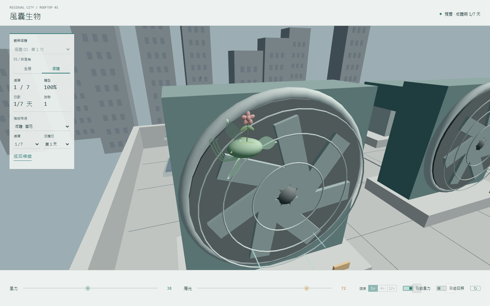

# M3 個體：風囊生物

> 截止：11/12（四）上課前 15:30

這一站把 M2 的物種設定翻成可觀察的個體行為。風囊生物會感受日照與風力，利用鉤索和膜翼移動、附著、生長、枯萎與繁殖。

## 這一站要交的四件套

- [x] 程式碼：[`index.html`](./index.html)、[`sketch.js`](./sketch.js) 與 [`rust/`](./rust/)
- [x] 作品截圖：[`preview.png`](./preview.png)
- [x] 反思：一百到兩百字
- [x] AI 揭露欄
- [x] 簡報 PDF：[`m3-簡報.pdf`](./m3-簡報.pdf)
- [x] 課前準備與物種日誌：[`notes.md`](./notes.md)

## 三個特徵

1. **植物型代謝**：有光時生長與開花，缺光時停止生長並枯萎。
2. **鉤索與膜翼**：第一根鉤索負責附著，膜翼增加受風面積，成熟後再補齊其餘鉤索。
3. **逐輪縮小**：每次完成生命循環後體型縮小 10%，每個個體最多七輪。

## 三種行為

1. **尋找棲地**：種子用 seek／arrive 導引，依目前速度逐漸轉向可附著的風扇或風口。
2. **感光生長**：日照控制出土、發芽、開花與枯萎；幼體三夜成熟期間不開花。
3. **乘風繁殖**：成體生活七天後才釋放後代，後代也能附著、成熟並完成相同循環。

三個特徵與三種行為如何對應設定書、演算法比較及案例研究，整理在 [`notes.md`](./notes.md)。

## 執行方式

Windows 可直接雙擊 [`開啟作品.bat`](./開啟作品.bat)，啟動本機伺服器並開啟作品。也可以自行從 repo 根目錄啟動靜態伺服器，再開啟 `/m3-creature/`。網頁會載入已編譯的 Rust WebAssembly，不必另外安裝 Rust。

## 操作方式

- 調整風力，觀察飄散、轉向、擺動與繁殖。
- 調整陽光，觀察發芽、開花與枯萎。
- 使用 1×、4× 或 12× 模擬速度，縮短完整生命循環的等待時間。
- 開啟自動風力與自動日照，觀看日夜循環。
- 用階段檢視直接查看種子、成熟、開花、繁殖及凋謝。
- 切換個體視角近看生物，右鍵拖曳可旋轉鏡頭。

## 反思

這一站我把原本能單獨運作的風囊生物放回完整屋頂環境，重新整理牠對風力、日照與棲地的反應。調整過程花了很多時間和 AI 溝通，功能各自測好後，放進大環境仍出現鏡頭、位置與生命階段互相影響的問題。我反覆測試並加入加速功能，才比較容易檢查完整循環。下一站我想讓多個個體之間的差異與互動更清楚。

## AI 揭露欄

| 項目 | 內容 |
|------|------|
| 工具 | Codex |
| 日期 | 2026-11-05、2026-11-12 |
| prompt 摘要 | 依課程 M3 要求，檢查現有風囊生物程式，補上 seek／arrive 導引與 1×／4×／12× 加速控制，整理三個特徵、三種行為、研究筆記、測試、截圖與發表簡報。 |
| 採用範圍 | AI 協助研究演算法、修改 Rust／WebAssembly、建立測試與整理交付檔案，並依照我先前說明的製作經驗整理反思文句。物種世界、生命週期、外型、三夜成熟、七天繁殖與七輪壽命等核心設定沿用我在 M1、M2 的決定。 |

## 補充資料

- [M3 設計、案例與導覽筆記](./notes.md)
- [Rust／WebAssembly 技術說明](./TECHNICAL.md)
